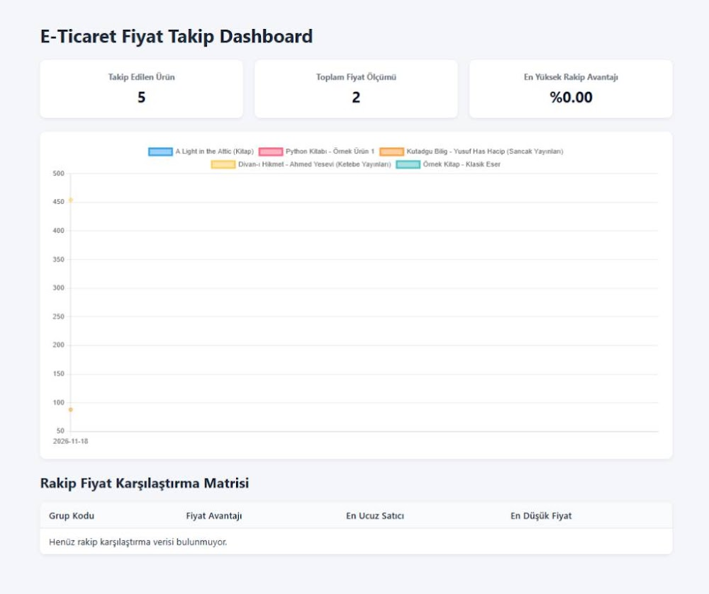

# E-Commerce Competitor Price Tracker / E-Ticaret Rakip Fiyat Takip Botu (v2.5)

## English & Türkçe

This project is an automated price monitoring, fake-discount detection (30-day anomaly analysis), and market intelligence system featuring Chart.js visual dashboards and Telegram alerts. / Bu proje, e-ticaret sitelerinde 30 günlük geçmiş verilerle sahte indirim tespiti yapan, rakip fiyatları kıyaslayan, interaktif Chart.js dashboard ve anlık Telegram bildirimleri üreten otomatik bir fiyat takip sistemidir.

### Key Modules / Temel Modüller
- `veritabani.py` & `kaziyici.py`: SQLite time-series DB and JSON-LD/CSS web scraper with 3x retry / SQLite zaman serisi veritabanı ve 3x deneme destekli web kazıyıcı.
- `anomali_analizci.py` & `karsilastirici.py`: 30-day fake-discount anomaly detector and competitor matrix / 30 günlük sahte indirim/anomali analizcisi ve rakip matrisi.
- `dashboard.py` & `bildirimci.py`: Interactive Chart.js HTML dashboard and Telegram alerts / Interaktif Chart.js HTML dashboard ve Telegram bildirim servisi.
- `otomatik_calistir.bat` & `main.py`: One-click Windows automation & system orchestration / Tek tıkla Windows otomasyon betiği ve sistem orkestrasyonu.

### Setup / Kurulum
1. Clone the repo and install dependencies: `pip install -r requirements.txt` / Depoyu klonlayıp gereksinimleri yükleyin.
2. Configure `hedefler.json` (and `.env` for Telegram) / `hedefler.json` ve `.env` dosyasını yapılandırın.
3. Run tests and start: `python -m unittest -v test_takipci.py` -> `python main.py` / Testleri çalıştırıp botu başlatın.
